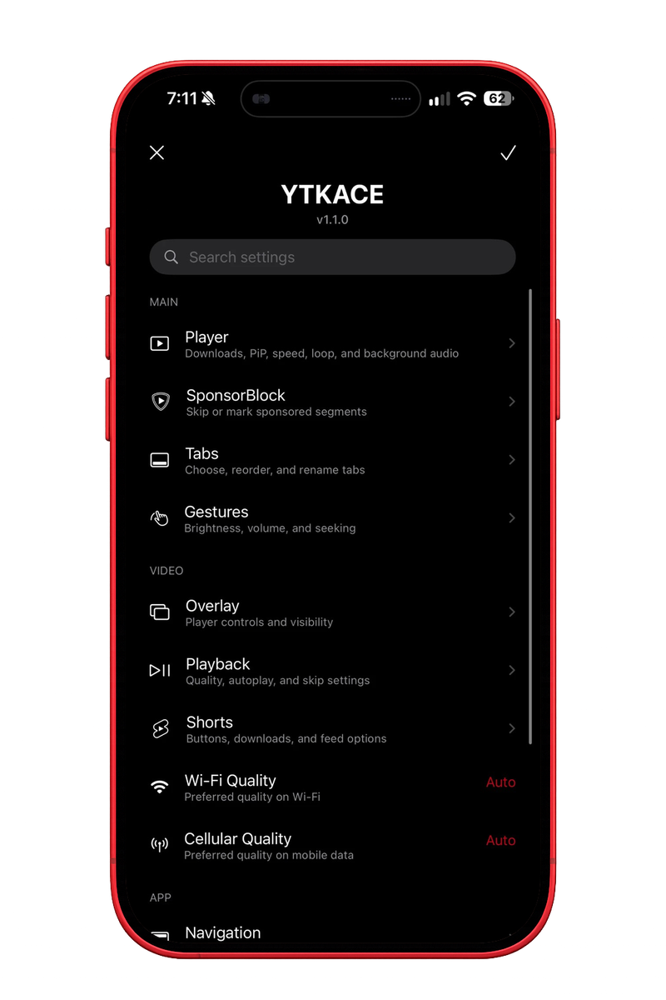
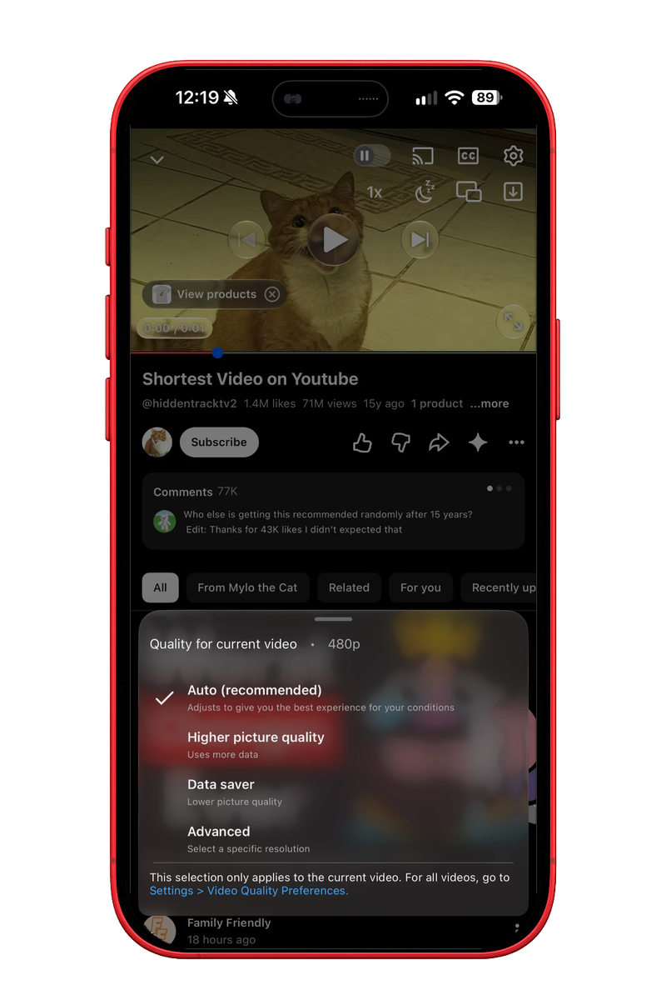

# HH

An open-source YouTube enhancement for iOS and Android, injected directly into the official YouTube application.

  

## Features

| Area | Included |
|---|---|
| Downloads | Video, audio, Shorts and whole-playlist downloads; built-in SABR/FFmpeg library on iOS, and integrated Download overlay button + native Download/Playlist hook (`YTDLnis` / `Seal`) on Android |
| Queue | Play next or play last without Premium, with queue manager controls |
| Playback | Background playback, PiP, loop, segment loop, speed controls, default speed & quality, swipe gestures (volume/brightness), custom double-tap to seek, PoToken & stream spoofing |
| SponsorBlock | Category controls, timeline color markers, automatic/manual skip modes and configurable alerts |
| Return YouTube Dislike | Public dislike counts via Return YouTube Dislike API and DeArrow alternative thumbnails |
| Interface | 100% native YouTube UI, OLED pure-black mode, ad/promo removal, overlay controls, navigation cleanup and native share sheets (with link tracking sanitization) |
| Liquid Glass (iOS 26) | Glass tab bar, top bar buttons, menus, sheets, player buttons and popups on iOS 26 |
| Tabs | Hide, reorder and customize YouTube navigation destinations and startup page |
| Settings | Native **HH** section inside YouTube Settings with search bar and 15+ languages (including English & Vietnamese) |

## Compatibility

### Android (Injected Official YouTube APK)
- **Android:** 8.0 (API 26) and newer (non-root & root supported)
- **Architecture:** `arm64-v8a`, `armeabi-v7a`
- **App Name & Icon:** `YouTube` (official stock icon & native YouTube interface; package `com.hoanghuy.hh.youtube` installs side-by-side with system YouTube)
- **HH:** 1.1.1

| APK | Base / Version | Purpose |
| --- | --- | --- |
| `HH_1.1.1_YouTube_21.13.164.apk` | Official YouTube 21.13.164 + 74 patches | Main injected YouTube app (native UI + `HH` settings) |
| `MicroG-RE_7.3.1_GmsCore.apk` | `app.revanced.android.gms` 7.3.1 | Required once on non-root Android for Google Sign-In |
| `YTDLnis` (optional) | Latest universal APK | Companion downloader triggered directly by in-app Download buttons for MP4/4K, MP3/M4A, Shorts & Playlists |

### iOS (Injected Official YouTube IPA)
- **iOS:** 15.0 and newer (tweak packages); the prebuilt IPAs follow their YouTube base
- **Architecture:** arm64
- **HH:** 1.1.1

| IPA | YouTube base | iOS |
| --- | --- | --- |
| `HH_1.1.1_YouTube_iOS16_21.33.6.ipa` | 21.33.6 | 16.0 and newer |
| `HH_1.1.1_YouTube_21.39.4.ipa` | 21.39.4 | 17.0 and newer |

## Install

### Android (Non-Root)
1. **Install GmsCore (`MicroG-RE`).** Install `MicroG-RE_7.3.1_GmsCore.apk` first (one-time setup) and sign in to your Google account.
2. **Install YouTube (`HH`).** Install `HH_1.1.1_YouTube_21.13.164.apk` and open **YouTube**.
3. **Direct Video / MP3 / Playlist Downloads (Optional).** Install `YTDLnis` (included in companion artifacts/releases) or `Seal`, then in **YouTube → Settings → HH → Overlay buttons / External downloader**, select `YTDLnis`.

### iOS (Jailbroken)
Add `https://itzzace.github.io/ytkace/` in Sileo, Zebra or Cydia.

### iOS (Sideloaded)
Download the IPA for your iOS version from the [latest release](https://github.com/HoangHuy206/HH-YouTube/releases) and install it with TrollStore, AltStore, SideStore or LiveContainer.

## Build

- **Android APK:** Open the **APK** workflow in GitHub Actions and click **Run workflow** (or run `bash Scripts/build-apk.sh` locally with Java 21+ and Python 3). It verifies the authentic Google YouTube `21.13.164` certificate, injects all 74 patches from `Android/options.json`, verifies the signed APK with `Tools/verify_apk.py`, and uploads `HH-APK` + `HH-Android-Companions`.
- **iOS IPA & Deb:** Open the **IPA** workflow in GitHub Actions and provide direct links to decrypted YouTube IPAs (`21.33.6` / `21.39.4`). The **Deb** workflow builds the tweak package.

## Settings

- **iOS:** Open the HH tab and tap the gear, or open YouTube Settings and choose **HH**.
- **Android:** Open YouTube → tap your profile picture → **Settings** → **HH** (with built-in search bar and full Vietnamese / English translations).

## Screenshots

  
  
  

  
  
  

## Privacy

HH has no activation service, analytics, telemetry or forced updater.

## License

iOS tweak source is available under the [MIT License](LICENSE). See [Third-Party Notices](THIRD_PARTY_NOTICES.md) for components, Android patch bundles, and services with separate terms.
