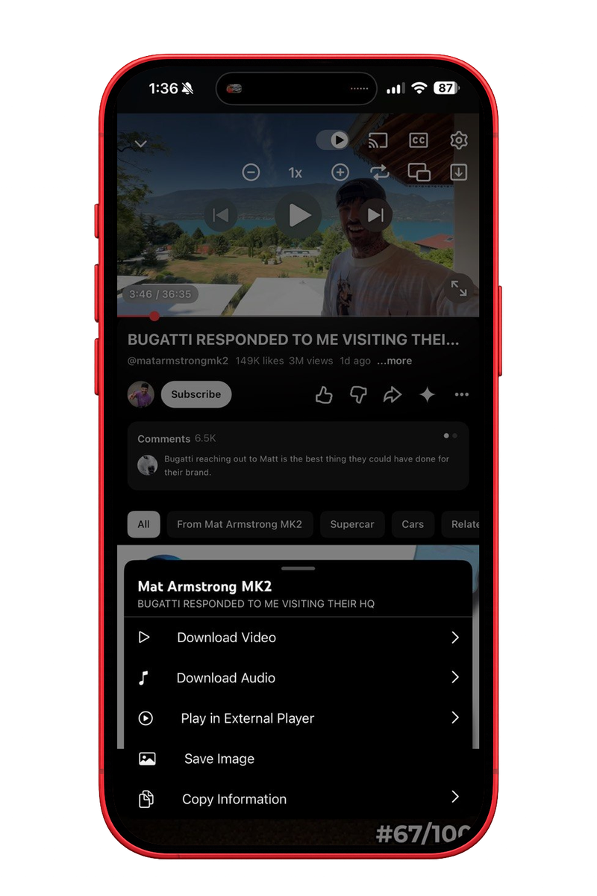
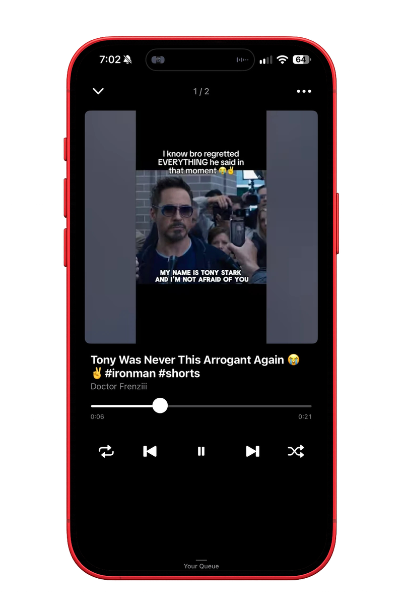
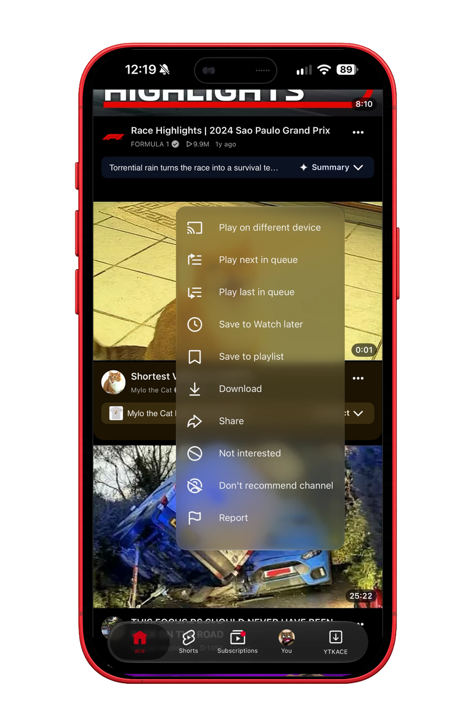
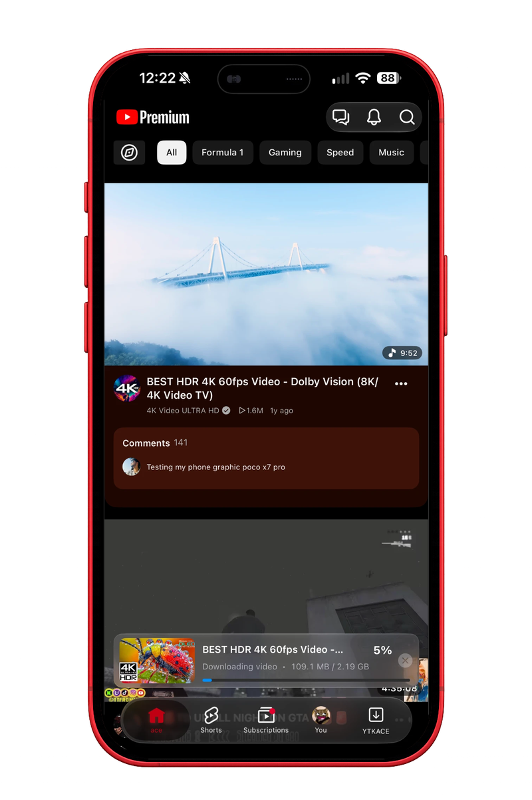

# HH

An open-source YouTube enhancement for iOS and Android.

<p>
  <a href="https://github.com/HoangHuy206/HH-YouTube/releases/latest/download/HH_1.1.1_YouTube.apk">
    
  </a>
  <a href="https://github.com/HoangHuy206/HH-YouTube/releases/latest">
    
  </a>
</p>

## Features

| Area | Included |
|---|---|
| Downloads | Built-in Video (up to 4K), Audio (`M4A`/`Opus`), Shorts and whole-Playlist / batch downloads directly inside the app on both iOS and Android — no external downloader app required |
| Queue | Play next, enqueue, drag-to-reorder, swipe to remove, shuffle, loop and clear without Premium |
| Playback | Background playback, Popup / Picture-in-Picture (PiP), sleep timer, loop, speed & pitch controls, default 1080p/4K resolution, swipe gestures (volume/brightness) and double-tap to seek |
| SponsorBlock | Built-in category controls, timeline color markers, automatic/manual skip modes and configurable alerts (enabled by default) |
| Return YouTube Dislike | Public dislike counts via Return YouTube Dislike API and DeArrow alternative thumbnails/titles |
| Account Login | Direct Google / YouTube account login inside the app without requiring GmsCore or MicroG |
| Interface | OLED pure-black mode (enabled by default), ad-free feed & player, Shorts filtering, and native share sheets |
| Liquid Glass (iOS 26) | Glass tab bar, top bar buttons, menus, sheets, player buttons and popups on iOS 26 |
| Tabs & Filters | Customize main page tabs, channel tabs, keyword/channel filters, and startup destinations |
| Settings | Searchable settings and multilingual interface including English & Vietnamese (`Tiếng Việt`) |

## Compatibility

### Android (Single All-in-One APK)
- **Android:** 7.0 (API 24) and newer — **1 single APK file**, no root, **no GmsCore/MicroG**, and **no external downloader** required
- **Architecture:** `arm64-v8a` (default) and `armeabi-v7a`
- **Package ID:** `com.hoanghuy.hh` (installs side-by-side with stock YouTube)
- **HH:** 1.1.1

| APK | Base | Requirements |
| --- | --- | --- |
| `HH_1.1.1_YouTube.apk` | PipePipe 5.6.0 (`arm64-v8a`) | Install directly — standalone single file (~34 MB) |

*(An optional `rvx` edition built against stock YouTube 21.13.164 is also available via `HH_APK_EDITION=rvx` in the build script/workflow).*

### iOS
- **iOS:** 15.0 and newer (tweak packages); the prebuilt IPAs follow their YouTube base
- **Architecture:** arm64
- **HH:** 1.1.1

| IPA | YouTube base | iOS |
| --- | --- | --- |
| `HH_1.1.1_YouTube_iOS16_21.33.6.ipa` | 21.33.6 | 16.0 and newer |
| `HH_1.1.1_YouTube_21.39.4.ipa` | 21.39.4 | 17.0 and newer |

Pick the 21.39.4 build unless you are on iOS 16. Either one installs with TrollStore or a developer-certificate sideloader.

## Install

### Android
Download `HH_1.1.1_YouTube.apk` and tap to install directly on your phone — **only 1 APK file is needed**. Open **HH** to watch ad-free with OLED black mode, SponsorBlock, background play, PiP, and built-in Video/Audio/Playlist downloads ready out of the box. To sign in to your YouTube account, open **Settings → Account → Log in to YouTube**.

### iOS (Jailbroken)
Add the repository in Sileo, Zebra or Cydia:

```
https://itzzace.github.io/ytkace/
```

Rootless and roothide packages are both published.

### iOS (Sideloaded)
Download the IPA for your iOS version from the [latest release](https://github.com/HoangHuy206/HH-YouTube/releases) and install it with TrollStore, AltStore, SideStore or LiveContainer.

## Build

### Android APK
- **GitHub Actions:** Open the **APK** workflow (`.github/workflows/build-apk.yml`) and click **Run workflow** (defaults to `allinone` single-APK edition; `rvx` is also selectable).
- **Local CLI (Java 21+ & Python 3):**
  ```bash
  bash Scripts/build-apk.sh
  ```

### iOS IPA & Deb
Fork the repository, enable Actions, open the **IPA** workflow and provide a direct link to a decrypted YouTube IPA you are legally allowed to use. The completed workflow provides the injected IPA as an artifact. The **Deb** workflow builds the tweak package.

## Screenshots

<p align="center">
  
  
  
</p>

<p align="center">
  <sub>Settings · Downloads · Audio Player</sub>
</p>

<p align="center">
  
  
  
</p>

<p align="center">
  <sub>Liquid Glass · Menus · Sheets · Tab Bar</sub>
</p>

## Privacy

HH has no activation service, analytics, telemetry or forced updater.

## License

iOS tweak source is available under the [MIT License](LICENSE). Android packages built from PipePipe / ReVanced Extended follow **GPLv3**; see [Third-Party Notices](THIRD_PARTY_NOTICES.md) for full component licenses and attributions.
